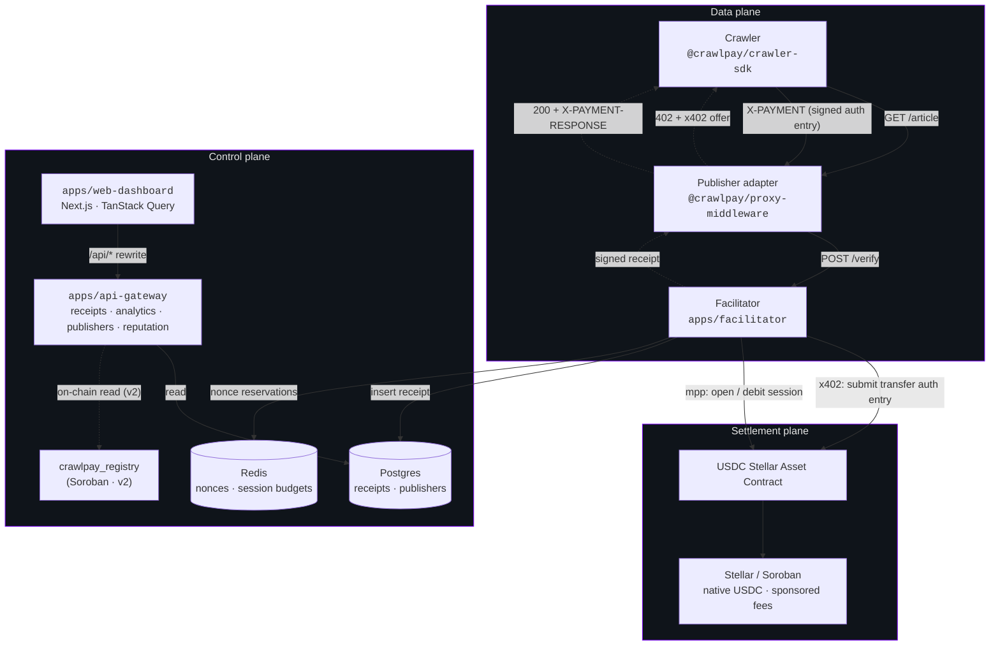
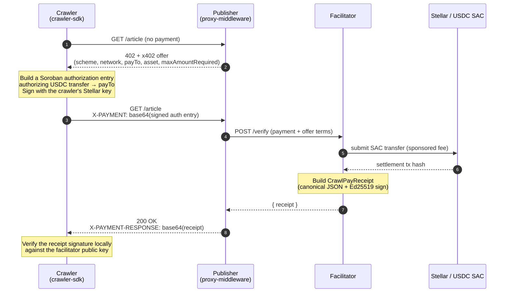

# CrawlPay

[](./LICENSE)
[](https://stellar.org)
[](https://nodejs.org)
[](https://www.typescriptlang.org)
[](https://pnpm.io)

Open-source pay-per-crawl infrastructure for the open web. Publishers charge AI crawlers per URL fetched in USDC at sub-cent prices; every fetch returns a portable, cryptographically signed receipt that is proof of paid access. Payments settle on **Stellar** — per request via **x402** over Soroban authorization entries, or in bulk via **MPP** sessions — in **native USDC**, with the transaction fee sponsored so the crawler never holds a gas token.

CrawlPay is the open, self-hostable alternative to Cloudflare's Pay Per Crawl, built for the ~80% of the web Cloudflare does not sit in front of. The full product spec lives in [`docs/PRD.md`](./docs/PRD.md).

> **Project status.** This repository is the in-progress migration to Stellar (the project began on the Arc testnet). The protocol, shared types, the Ed25519 receipt signer/verifier, the publisher middleware, the crawler SDK, the facilitator, and the API gateway are implemented and tested. The live Soroban settlement path — signing authorization entries, submitting the USDC SAC `transfer`, and MPP sessions — is the active v0 build, tracked in the repository [issues](https://github.com/vegaforge/crawlpay/issues). Modules that depend on it expose their interfaces and fail fast with an explicit "not implemented" until that lands.

## Table of contents

- [Problem and approach](#problem-and-approach)
- [Why Stellar](#why-stellar)
- [Architecture](#architecture)
- [Protocol flow](#protocol-flow)
- [Settlement models](#settlement-models)
- [Receipt model](#receipt-model)
- [Tech stack](#tech-stack)
- [Repository layout](#repository-layout)
- [Getting started](#getting-started)
- [Documentation](#documentation)
- [Roadmap](#roadmap)
- [Contributing](#contributing)
- [License](#license)
- [References](#references)

## Problem and approach

The web's economic model assumes humans. Humans browse slowly, click ads occasionally, sometimes subscribe. AI crawlers don't. A single research bot can fetch a million pages a week. At that volume, ad-supported sites are uneconomical (crawlers don't see ads), subscription-only sites are inflexible (they overcharge tiny readers and undercharge industrial bots), and outright blocking leaves money on the table while pushing crawlers to scrape harder. The economically right answer is **per-fetch pricing as small as $0.0001**.

No conventional payment rail makes that viable. Stripe's flat $0.30 minimum is a 300,000% fee on a $0.0001 charge. Cloudflare's Pay Per Crawl exists but is gated to enterprise customers and only covers sites already behind Cloudflare. The whole long tail — small publishers, indie news, niche research databases — has no option.

CrawlPay makes per-fetch pricing work by composing three things that are already live on Stellar:

- **x402 over Soroban authorization entries.** The crawler signs an authorization entry that authorizes a single USDC `transfer` from itself to the publisher, scoped to a short window and a nonce. One request, one signed authorization.
- **MPP sessions (the Machine Payments Protocol).** For high-volume access, the crawler pre-authorizes a budget once and streams per-URL debits that settle in bulk — a standardized batching primitive, not a proprietary aggregation service.
- **Native USDC on Stellar.** No wrapped or bridged representation and no bridge risk. The facilitator sponsors the transaction fee, so the crawler funds a USDC budget and nothing else — it never needs to hold the gas asset.

The protocol layer is **x402**: a protected URL returns a standard `402 Payment Required` with a JSON offer when called without payment, and a `200 OK` with a signed receipt header when payment is presented. Anything that doesn't care still sees a URL, a status code, and a body. Crawlers that do care install one SDK and pay transparently — and because the signature format aligns with **Web Bot Auth** and the payment with **x402**, a crawler already integrated for Cloudflare or another x402 service can pay CrawlPay with almost no new code.

Every paid fetch produces a **portable, signed receipt** — verifiable by anyone holding the receipt and the facilitator's public key, with no access to CrawlPay's database. Receipts double as audit logs, billing records, and evidence of paid access in any licensing or copyright dispute.

## Why Stellar

A Stellar account _is_ an Ed25519 keypair, so one key is the crawler's payment account, its Web Bot Auth request-signing identity, and its reputation subject at once. Beyond that, Stellar fits pay-per-crawl on the merits: native USDC with no bridge; server-sponsored fees so the agent holds no gas token; MPP sessions as a native batching primitive; a ~$0.00001 base fee that makes even unbatched per-request settlement economically sane; and — the sleeper advantage — a **fiat off-ramp through Stellar's anchor network**, so a long-tail publisher in an emerging market can convert USDC earnings to local currency through existing cash-out rails. See [`docs/PRD.md` §4](./docs/PRD.md) for the full rationale and the honest tradeoffs.

## Architecture

CrawlPay separates concerns across three planes — **data**, **settlement**, and **control** — so no plane's failure modes block the others. The data plane handles HTTP fetches and the synchronous verify call; the settlement plane moves USDC on Stellar; the control plane serves dashboards, the API, and (from v2) on-chain reads, and is read-only relative to the hot path.



**Data plane.** One enforcement core behind thin adapters (Section 7 of the PRD): the middleware classifies a request, returns a 402 offer when payment is due, forwards the crawler's `X-PAYMENT` to the facilitator's `/verify`, and returns the signed receipt. The facilitator owns settlement and receipt signing, so the adapter stays small and identical everywhere.

**Settlement plane.** The facilitator verifies the signed Soroban authorization entry against the offer terms, submits the USDC SAC `transfer` (sponsoring the fee), and — for high-volume crawlers — debits an MPP session that settles in bulk. USDC moves directly from crawler to publisher; CrawlPay never custodies funds.

**Control plane.** Read-mostly. The api-gateway serves receipts, analytics, publisher onboarding, and provisional reputation from Postgres, gating writes behind a publisher **API key** (bearer token). It never touches the hot path; if it's down, fetches and settlement keep working. The web dashboard is a Next.js client that talks to the gateway through a same-origin `/api/*` rewrite.

## Protocol flow



**Phase 1 — Discovery.** The crawler reads price out of band (a `/.well-known/crawlpay` manifest or robots.txt extension) or learns it in band from the 402 offer.

**Phase 2 — Offer.** The middleware classifies the request and, if payment is due, returns a 402 with an x402 offer naming the Stellar network, the USDC asset, the publisher payout address, and `maxAmountRequired` in atomic USDC (7 decimals; `1000` = $0.0001).

**Phase 3 — Authorization.** The crawler builds a Soroban authorization entry for the USDC SAC `transfer`, scoped to a short signature window and a nonce, and signs it with its Stellar key. The base64-encoded entry rides in the **`X-PAYMENT`** header.

**Phase 4 — Verification and settlement.** The facilitator validates the offer terms, reserves the nonce (replay barrier), submits the SAC transfer with a sponsored fee, then signs the receipt.

**Phase 5 — Delivery.** The middleware returns `200` plus the signed receipt in **`X-PAYMENT-RESPONSE`**. The crawler verifies the signature locally — it already has the facilitator's public key.

## Settlement models

|          | **x402 per-request** (default)         | **MPP session** (high volume)              |
| -------- | -------------------------------------- | ------------------------------------------ |
| Unit     | One signed authorization entry per URL | One pre-authorized budget, many debits     |
| On-chain | One SAC transfer per request           | One bulk settlement per session            |
| Best for | The long tail; maximum accountability  | Thousands of fetches/hour at one publisher |
| Receipt  | One per URL                            | One per URL (settlement backfills the tx)  |

Both paths produce the **same canonical signed receipt**, so downstream verification and legal use are identical. The SDK picks per-request x402 by default and opens an MPP session when it detects sustained high-frequency access above a threshold.

## Receipt model

Every paid fetch produces a `CrawlPayReceipt` — portable cryptographic evidence, signed with the facilitator's Ed25519 (Stellar) key over a canonical JSON form:

```typescript
interface CrawlPayReceipt {
  version: '1';
  resource: string; // the URL paid for
  amount: string; // atomic USDC (7 decimals), stringified
  asset: string; // 'USDC:GISSUER…'
  network: 'stellar-testnet' | 'stellar-mainnet';
  from: string; // crawler G-address
  to: string; // publisher payout G-address
  nonce: string; // authorization nonce (replay key)
  timestamp: string; // ISO 8601 UTC
  settlement: 'x402' | 'mpp';
  onchainTxHash: string | null; // SAC transfer hash; null for mpp until bulk settle
  mppSessionRef: { sessionId: string; sequence: number } | null;
  facilitatorPubkey: string; // signer's G-address
  signature: string; // base64 Ed25519 over canonical(body)
}
```

Receipts sign over a **canonical JSON form** with lexicographic key ordering and stable serialization, so any field mutation invalidates the signature. Verification recomputes the canonical bytes and checks the Ed25519 signature against the embedded `facilitatorPubkey` — no recovery, no database, no trust in CrawlPay required. See [`packages/receipt-signer`](./packages/receipt-signer).

## Tech stack

| Layer          | Tools                                                                 |
| -------------- | --------------------------------------------------------------------- |
| Language       | TypeScript 5.4 strict, ES2022 target                                  |
| Runtime        | Node 20+ · pnpm 9 workspaces · Turbo                                  |
| Backend HTTP   | Fastify (facilitator, api-gateway)                                    |
| Frontend       | Next.js 15 (App Router) · React 18 · Tailwind · TanStack Query        |
| Stellar        | `@stellar/stellar-base` (Ed25519 keys, strkey, signing) · Soroban RPC |
| Receipt crypto | Ed25519 over canonical JSON                                           |
| Persistence    | Postgres 16 (`pg`) · Redis 7 (`ioredis`)                              |
| On-chain (v2)  | `crawlpay_registry` Soroban contract (Rust, soroban-sdk)              |
| Testing        | Vitest                                                                |

## Repository layout

```
crawlpay/
├── apps/
│   ├── facilitator/           x402/MPP verification · Soroban settlement · receipt signing
│   ├── api-gateway/           Receipts · analytics · publishers · API-key auth · reputation
│   └── web-dashboard/         Landing · onboarding · publisher + crawler dashboards
├── packages/
│   ├── types/                 Shared protocol types (offer, receipt, AtomicUsdc, …)
│   ├── receipt-signer/        Canonical-JSON Ed25519 sign + verify
│   ├── proxy-middleware/      Drop-in Express middleware for publishers
│   ├── crawler-sdk/           Buyer SDK (budgets, retries, cache, payment signing)
│   └── persistence/           Postgres + Redis + in-memory repos and migrations
├── contracts/                 Soroban registry + pools (Rust, v2)
├── infra/                     Docker Compose for Postgres + Redis
└── docs/                      PRD and architecture docs
```

## Getting started

### Prerequisites

- Node 20+ and pnpm 9
- Docker (for local Postgres + Redis)

### Install and verify

```bash
git clone https://github.com/vegaforge/crawlpay
cd crawlpay
pnpm install

cp .env.example .env   # fill in the Stellar settings (see comments in the file)

pnpm typecheck         # tsc --noEmit across the workspace
pnpm test              # Vitest across packages with tests
```

### Bring up infrastructure

```bash
pnpm infra:up          # Postgres + Redis via Docker Compose
pnpm migrate           # apply the schema
```

### Run the stack

Each in its own terminal:

```bash
pnpm --filter @crawlpay/facilitator dev   # :3001
pnpm --filter @crawlpay/api-gateway dev   # :8080
pnpm web:dev                              # :3000
```

See [`.env.example`](./.env.example) for the full, documented environment-variable reference (Soroban RPC URL, network, USDC asset and SAC address, facilitator signing seed, fee-sponsor seed, database and Redis URLs).

## Documentation

- [`docs/PRD.md`](./docs/PRD.md) — the complete product requirements document: problem, market, protocol, settlement, identity, security, and roadmap
- [`.env.example`](./.env.example) — canonical environment-variable reference
- [`CONTRIBUTING.md`](./CONTRIBUTING.md) — development workflow and the issue-driven, one-PR-per-issue process
- [`SECURITY.md`](./SECURITY.md) — how to report vulnerabilities

## Roadmap

| Version           | Focus                                                                                                                                 | Status          |
| ----------------- | ------------------------------------------------------------------------------------------------------------------------------------- | --------------- |
| **v0** (testnet)  | Protocol, receipt signing, adapters, SDK, facilitator, gateway, dashboard; live Soroban x402 + one MPP path; 60-fetch demo            | **in progress** |
| v1 (mainnet beta) | WordPress/Ghost/Substack plugins · edge adapters · hosted proxy · discovery manifest · Python SDK · Go gateway · anchor fiat cash-out | Q3 2026         |
| v2 (reputation)   | `crawlpay_registry` on-chain identity + reputation + key directory · validator network · discovery catalog · publisher pools          | Q4 2026–Q1 2027 |
| v3 (scale)        | CCTP cross-chain payout · subscription/deferred models on MPP · enterprise (SLA, HSM, SSO) · Helm/Kubernetes                          | 2027            |

## Contributing

CrawlPay follows an issue-driven, open-source workflow: every pull request resolves a tracked issue, and bugs are filed as issues before they're fixed. Start with [`CONTRIBUTING.md`](./CONTRIBUTING.md) and the [good first issues](https://github.com/vegaforge/crawlpay/issues?q=is%3Aissue+is%3Aopen+label%3A%22good+first+issue%22).

## License

[Apache License 2.0](./LICENSE). OSI-approved, includes a patent grant.

## References

- [x402 specification](https://x402.org) — HTTP-native payment negotiation
- [Stellar / Soroban](https://developers.stellar.org) — smart contracts, the Stellar Asset Contract, and Soroban RPC
- [USDC on Stellar](https://www.circle.com/usdc) — native USDC issued by Circle
- [Web Bot Auth](https://datatracker.ietf.org/doc/draft-meunier-web-bot-auth-architecture/) — HTTP Message Signatures for crawler identity
- [Cloudflare Pay Per Crawl](https://blog.cloudflare.com/introducing-pay-per-crawl/) — the proprietary incumbent CrawlPay is the open alternative to
